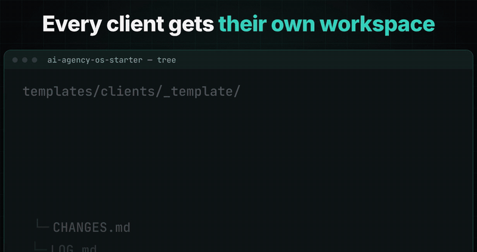

# AI Agency OS — Free Client Ops Starter for Claude Code

[](LICENSE)
[](https://docs.anthropic.com/en/docs/claude-code)
[](https://docs.anthropic.com/en/docs/claude-code/skills)
[](skills)
[](https://github.com/CalebAnderson-Coder/ai-agency-os-starter/stargazers)

<p align="center"></p>

**Run several clients from Claude Code without mixing their voice, rules or scope — and stop doing "quick favors" for free.**

## The problem
If you run an AI / marketing agency or freelance for several clients, Claude Code has one big context:
- Client A's tone shows up in Client B's email. Claims you never approved slip into copy.
- "Can you just quickly…" requests pile up and nobody bills them.
- Every new client means re-explaining the same rules from scratch.

AI Agency OS gives each client an isolated workspace (its own `CLAUDE.md`, voice, approved claims, scope and log) plus procedures that check every request against the contract.

## Install in 30 seconds
```bash
git clone https://github.com/CalebAnderson-Coder/ai-agency-os-starter && cd ai-agency-os-starter
./install.sh ~/agency      # Windows: powershell -ExecutionPolicy Bypass -File .\install.ps1 -Target C:\agency
cd ~/agency && claude      # then type /skills
```
Run `./install.sh` with no argument to install globally into `~/.claude`. Details: [INSTALL.md](INSTALL.md).

Using **Codex** or another agent that reads `SKILL.md`? Copy the folders under `skills/*/` into that agent's skills directory — they are plain Markdown.

## What's in this repo (free)
| Skill | What it does |
|---|---|
| [`client-workspace`](skills/clients/client-workspace/SKILL.md) | One folder + `CLAUDE.md` per client: voice, approved claims, rules, logs |
| [`scope-guard`](skills/clients/scope-guard/SKILL.md) | Checks requests against `SCOPE.md`, quotes extras, drafts the reply, logs `CHANGES.md` |
| [`offer-builder`](skills/sales/offer-builder/SKILL.md) | Productized offer + pricing ladder |
| [`cold-email-agency`](skills/sales/cold-email-agency/SKILL.md) | 4-step cold email sequences for US SMB owners |

Plus [`templates/clients/_template/`](templates/clients/_template) (CLAUDE.md, BRIEF, SCOPE, CHANGES, LOG, brand voice & claims) and a worked example in [`examples/acme-plumbing/`](examples/acme-plumbing).

## Full skill walkthrough: `scope-guard`
`examples/acme-plumbing/SCOPE.md` (fictional client): 4 Meta ad creatives/month, website text edits up to 2 h, **no new landing pages**, extra work at $90/h. Four ads already delivered this month.

The client emails:
> Can you make 3 more Facebook ads for the water-heater promo? Also, while you're at it, a small landing page for the promo? And please fix the phone number typo on the Contact page.

You, inside `clients/acme-plumbing`:
```
Run scope-guard on this request.
```
Claude reads `SCOPE.md` + `CHANGES.md` and returns:

| Ask | Class | Evidence | Hours | Quote |
|---|---|---|---|---|
| 3 more Meta ad creatives | OVER QUANTITY | SCOPE row 2: 4/month, 4 delivered | 3 h | $270 |
| Promo landing page | OUT OF SCOPE | "Not included: new landing pages" | 6 h | $540 |
| Phone typo fix | IN SCOPE | SCOPE row 4: text edits up to 2 h | 0.25 h | included |

…plus a ready-to-send (never auto-sent) reply that offers a paid add-on **or** a swap, and three new rows in `CHANGES.md`. Full output: [`expected-output.md`](examples/acme-plumbing/expected-output.md).

Try it yourself:
```bash
mkdir -p ~/agency/clients && cp -R examples/acme-plumbing ~/agency/clients/
cd ~/agency/clients/acme-plumbing && claude
```

## Free vs paid
| | **Free** (this repo) | **Starter** $29 | **Pro** $99 | **Agency** $249 |
|---|:-:|:-:|:-:|:-:|
| `client-workspace`, `scope-guard`, `offer-builder`, `cold-email-agency` | ✅ | ✅ | ✅ | ✅ |
| Client folder template | ✅ | ✅ | ✅ | ✅ |
| `client-onboarding`, `proposal-sow`, `monthly-client-report` | — | ✅ | ✅ | ✅ |
| Agency rules file | — | `CLAUDE-lite.md` | full `CLAUDE.md` + routing table | full `CLAUDE.md` + routing table |
| `client-qa` (separate reviewer), `prospecting` | — | — | ✅ | ✅ |
| Automation: `inbox-triage`, `meeting-to-tasks`, `scheduled-drafts` | — | — | ✅ | ✅ |
| Delivery: `nextjs-supabase-app`, `geo-quick-audit` | — | — | ✅ | ✅ |
| 5 agents: orchestrator, account-manager, client-reviewer, dev-builder, growth-operator | — | — | ✅ | ✅ |
| Bonus skills | — | — | 2 (conversion copywriting, Meta ads playbook) | 13 (content engine, carousels, UGC scripts, Meta ads launch & metrics, landing pages, llms.txt, Supabase RLS, debugging, captions…) |
| Agency kit: SOPs, SOW & change-order templates, 3 productized offers + pricing sheet, prospecting scripts, report template, 4 scheduled job runners | — | — | — | ✅ |
| QUICKSTART guide | — | — | ✅ | ✅ |
| **Total skills** | **4** | **7** | **16** | **27** |

All paid plans: 30-day money-back guarantee.

## Get it
- 📥 **Free zip + updates by email:** https://brianspark283.gumroad.com/l/ai-agency-os-free?utm_source=github&utm_medium=readme
- 🚀 **Starter — $29** (7 client-ops skills): https://brianspark283.gumroad.com/l/ai-agency-os-starter?utm_source=github&utm_medium=readme
- Pro — $99: https://brianspark283.gumroad.com/l/ai-agency-os-pro?utm_source=github&utm_medium=readme · Agency — $249: https://brianspark283.gumroad.com/l/ai-agency-os-agency?utm_source=github&utm_medium=readme

If this saved you an unbilled hour, a ⭐ helps others find it.

MIT · Not affiliated with Anthropic or OpenAI.
